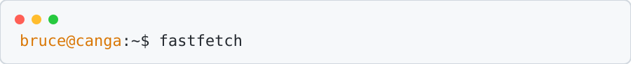

<div align="center">

<picture>
  <source media="(prefers-color-scheme: dark)" srcset="assets/terminal-dark.svg">
  <source media="(prefers-color-scheme: light)" srcset="assets/terminal-light.svg">
  
</picture>

</div>

<table>
  <tr>
    <td width="42%" valign="top">

```text
             .----------------.
            / .--------------. \
           / /                \ \
          | |    .--------.    | |
          | |   /  /\  /\  \   | |
          | |  |  /  \/  \  |  | |
          | |  | |  /\  /\ | |  | |
          | |   \ \/  \/  / /   | |
          | |    '--------'    | |
           \ \                / /
            \ '--------------' /
             '----------------'
```

    </td>
    <td valign="top">

<pre><span style="color:#f59e0b">bruce@canga</span>
----------------
<span style="color:#f59e0b">OS</span>                 <span style="color:#60a5fa">Windows 11</span>
<span style="color:#f59e0b">Uptime</span>             <span style="color:#60a5fa">[Your age here]</span>
<span style="color:#f59e0b">Host</span>               <span style="color:#60a5fa">Mapua Malayan Colleges Laguna</span>
<span style="color:#f59e0b">Kernel</span>             <span style="color:#60a5fa">BS Information Technology</span>
<span style="color:#f59e0b">IDE</span>                <span style="color:#60a5fa">Visual Studio 2022, Visual Studio Code</span>
<span style="color:#f59e0b">Programming</span>       <span style="color:#60a5fa">C#, Python, GDScript</span>
<span style="color:#f59e0b">Computer Languages</span> <span style="color:#60a5fa">HTML, CSS, TypeScript</span>
<span style="color:#f59e0b">Real Languages</span>    <span style="color:#60a5fa">English, Tagalog</span>
<span style="color:#f59e0b">Hobbies</span>            <span style="color:#60a5fa">Game Development, Custom Discord Bots, Valorant</span></pre>

    </td>
  </tr>
</table>

## Contact

<pre><span style="color:#f59e0b">Email</span>    <span style="color:#60a5fa">[your-email@example.com]</span>
<span style="color:#f59e0b">Discord</span>  <span style="color:#60a5fa">[your-discord-username]</span></pre>

## GitHub Stats

<pre><span style="color:#f59e0b">Repos</span>          <span style="color:#60a5fa">[00]</span>
<span style="color:#f59e0b">Stars</span>          <span style="color:#60a5fa">[00]</span>
<span style="color:#f59e0b">Commits</span>        <span style="color:#60a5fa">[00]</span>
<span style="color:#f59e0b">Followers</span>      <span style="color:#60a5fa">[00]</span>
<span style="color:#f59e0b">Lines of Code</span>  <span style="color:#60a5fa">[00]</span></pre>

<div align="center">

```text
┌──────────────────────────────────────────────────────────────┐
│  [ SYSTEM READY ]  Welcome to my corner of the internet.     │
└──────────────────────────────────────────────────────────────┘
```

</div>
